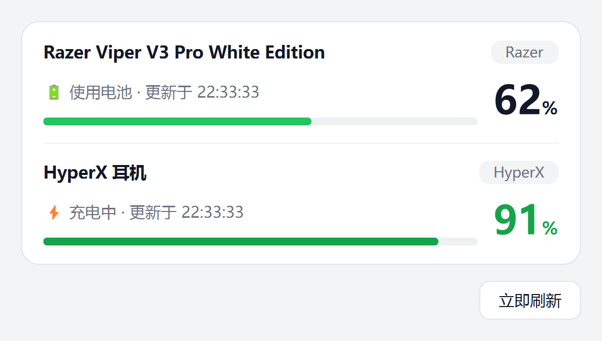

# 外设电量监控（Peripheral Battery Monitor）

一个自用的 Windows 桌面小工具，实时监控两台外设的电量：

| 设备 | 读取方式 |
|---|---|
| 雷蛇鼠标（Razer Viper V3 Pro，Synapse 4） | 读取 Razer Synapse 的日志文件 |
| HyperX Cloud III Wireless（飓风3）耳机 | 直接通过 USB HID 与接收器通信 |

界面用 PySide6，常驻系统托盘，另有一个可长时间停在桌面上的**磨砂玻璃小插件**；
**不逆向雷蛇 USB 协议**，HyperX **不经过 NGENUITY**。



桌面小插件（始终置顶、可拖动、贴边吸附）：


---

## 目录结构

```
.
├── main.py                  # 程序入口（主窗口 + 桌面小插件 + 托盘）
├── config.py                # 路径、日志、所有可调常量
├── models.py                # 统一数据模型 DeviceStatus
├── adapters/
│   ├── base.py              # 适配器基类（异常隔离）
│   ├── razer.py             # RazerAdapter：读 Synapse 日志
│   ├── hyperx.py            # HyperXAdapter：USB HID 直连
│   └── manager.py           # DeviceManager：每个适配器一条线程
├── ui/
│   ├── main_window.py       # 主窗口（紧凑竖排）
│   ├── widget.py            # 桌面小插件（无边框 / 置顶 / 拖动吸附）
│   └── tray.py              # 系统托盘（图标 / 菜单 / tooltip）
├── tools/
│   ├── hyperx_probe.py      # HID 探测/校准脚本
│   ├── check_manager.py     # 命令行轮询自检
│   └── make_icon.py         # 生成 assets/app.ico（托盘与 exe 图标同源）
├── assets/
│   ├── app.ico              # 应用图标（exe / 托盘）
│   ├── app.png              # 同上的 PNG 版（备用）
│   ├── widget.png           # 桌面小插件截图（README 用）
│   └── screenshot.png       # 主界面截图（README 用）
├── PeripheralBattery.spec   # PyInstaller 打包配置
├── requirements.txt
├── .gitignore
└── README.md
```

---

## 安装与运行

需要 **Python 3.11+**（实测 3.13）。

```powershell
git clone https://github.com/<你的用户名>/<仓库名>.git
cd <仓库名>

python -m venv .venv
.\.venv\Scripts\python.exe -m pip install -r requirements.txt

# 正常启动（主窗口 + 桌面小插件 + 托盘）
.\.venv\Scripts\python.exe main.py

# 开机自启用：不弹主窗口，只在桌面上停着小插件（+ 托盘）
.\.venv\Scripts\python.exe main.py --tray

# 只想用小插件、永远不弹主窗口
.\.venv\Scripts\python.exe main.py --widget

# 打开调试日志
.\.venv\Scripts\python.exe main.py --debug
```

> 国内直连 PyPI 可能很慢（实测 ~10 KB/s），建议用镜像：
> `.\.venv\Scripts\python.exe -m pip install -i https://pypi.tuna.tsinghua.edu.cn/simple -r requirements.txt`

`hidapi` 的 Windows wheel 自带 `hidapi.dll`，不需要额外装原生库，也不需要管理员权限。

程序自身日志写到：`%LOCALAPPDATA%\PeripheralBattery\app.log`
配置文件：`%LOCALAPPDATA%\PeripheralBattery\config.json`（首次运行自动生成）。

---

## 桌面小插件

一个常驻桌面的迷你卡片，扫一眼就知道两台设备还剩多少电：

- **无边框、不占任务栏**，默认停在屏幕右下角（离可用区域边缘 16 px）。
- **拖动**：左键按住任意位置就能拖；拖到屏幕边缘附近松手会**自动吸附**，同样留 16 px 边距。
- **记住位置**：松手即写入 `config.json` 的 `ui.widget_x` / `ui.widget_y`。
  换显示器或改分辨率后如果落在屏幕外，启动时会自动拉回可见区域。
- **始终置顶**（右键菜单里可以关掉）。
- **双击** → 打开主窗口；**右键** → 菜单（打开主窗口 / 立即刷新 / 始终置顶 / 隐藏小插件 / 退出）。

颜色规则和主窗口一致：绿色正常、**红色低于 20%**、蓝色充电中、灰色读不到。
设备名过长会自动省略，完整名字看悬停提示。
设备多于两台时卡片会自动加高。

托盘右键菜单里的 **"桌面小插件"** 是勾选项，随时开关，开关状态会记进配置。

相关配置项：

```json
{
  "ui": {
    "widget_enabled": true,        // 启动时是否显示小插件
    "widget_always_on_top": true,
    "widget_x": null,              // null = 默认右下角；拖动后自动写入
    "widget_y": null
  }
}
```

### 磨砂玻璃是怎么做的

卡片表面是**程序自己画的**：半透明白色的竖向渐变 + 1 px 高光描边 + 一层柔和投影，
外面留 8 px 透明边距给投影，所以窗口本身仍是异形/半透明窗口。

没有使用 Windows 的亚克力接口（`SetWindowCompositionAttribute`）。实测过它：
给出的是由**壁纸亮度**决定的、几乎不透明的白灰色，透不出卡片后面的内容，
深色壁纸下还会把深色文字压糊，并且拖动时明显掉帧。自己画的一层在任何壁纸、
任何 Windows 版本下表现都一致，也不吃性能。

---

## 工作原理

### RazerAdapter（读日志，不碰 USB 协议）

Synapse 会把整份设备列表（含电量）持续写进纯文本日志，直接读增量即可：

1. 按优先级找日志，取**最后修改**的那个：
   - Synapse 4：`%LOCALAPPDATA%\Razer\RazerAppEngine\User Data\Logs\systray_systrayv*.log`
   - Synapse 3：`%LOCALAPPDATA%\Razer\Synapse3\Log\Razer Synapse 3.log`
2. **增量读取**：记录上次读到的 byte offset，只读新增内容；日志被清空/轮转会重新加载。
3. 主解析路径：把日志行 `~` 之后的 JSON 解析出来，读 `powerStatus.level` 与
   `powerStatus.chargingStatus`（实测可靠，胜过纯正则）。
4. 兜底正则：`(?i)battery[^\d]{0,20}(\d{1,3})\s*%?`（以及 `"level":N`）。
5. `watchdog` 监听日志目录，有新行时立即读取；5 秒轮询兜底。

实测日志片段：

```json
"productName":{"en":"Razer Viper V3 Pro White Edition"},
"powerStatus":{"chargingStatus":"NoCharge_BatteryFull","level":80}
```

`chargingStatus` 的取值：

| 值 | 含义 |
|---|---|
| `Charging` | 充电中 |
| `NoCharge_BatteryFull` | 使用电池（这是雷蛇的命名怪癖，70–80% 也叫 BatteryFull） |
| `off` | 鼠标关闭 / 休眠 |

### HyperXAdapter（USB HID 直连）

接收器暴露一个厂商自定义 HID 接口（不经过 NGENUITY）：

- VID `0x03F0`，运行时枚举，优先选 **usage page `0xFF13`**（Cloud III Wireless 实测）
- 发送：52 字节，`66 89` 后补零（**写的时候不要加 report-id 前缀**）
- 响应：

```
66 89 <mv_hi> <mv_lo> <level> 00 ...
[0]    0x66        报告回显
[1]    0x89        命令回显
[2..3]             电池电压，大端序，单位毫伏
[4]                电量 0-100（>100 表示耳机未开机/超出范围）
[5..]              全 0
```

- **充电不在响应里**：插上充电线时耳机会多枚举出一个 PID `0x06B7` 的设备，出现即表示充电中。
- 接收器被拔掉 → 捕获异常、返回 `online=False`，下次轮询自动重连。

实测：`66 89 0F FB 39` → 4091 mV、57%，`charging=True`。

---

## 校准 HyperX 电量字节（换批次/固件时用）

如果换了设备或固件，电量字节位置可能不同，用探测脚本重新确认：

```powershell
.\.venv\Scripts\python.exe tools\hyperx_probe.py
.\.venv\Scripts\python.exe tools\hyperx_probe.py --watch -v   # 连续看
```

输出内容：

- 列出所有 HyperX HID 接口（VID / PID / usage_page / usage / 路径）
- 是否检测到充电设备 `0x06B7`
- 发送电量查询后的**原始响应字节**（带下标）与候选解释

确认后，把结果写进 `%LOCALAPPDATA%\PeripheralBattery\config.json`：

```json
{
  "hyperx": {
    "vendor_id": 1008,
    "dongle_pid": 1463,
    "usage_page": 65299,
    "charging_pid": 1719,
    "report_prefix": 102,
    "battery_command": 137,
    "packet_length": 52,
    "battery_offset": 4,
    "millivolt_offset": 2,
    "max_valid_level": 100,
    "poll_interval": 15.0
  }
}
```

（上面的十进制只是为了示例；用 `0x` 十六进制字符串也可以，程序按数字读取。）

**代码里没有任何"电量一定在第 N 字节"的硬编码**——偏移全部来自配置。

---

## 命令行自检

不想开界面、只想确认两个适配器是否正常：

```powershell
.\.venv\Scripts\python.exe tools\check_manager.py -t 30
```

会打印每次更新、主线程心跳（证明没有阻塞）以及最终快照。

---

## 常见问题

**托盘里只有 "--"、提示找不到 Synapse 日志**
- 确认 Razer Synapse 正在运行，并已识别到鼠标（打开 Synapse 能看到鼠标）。
- 确认 `%LOCALAPPDATA%\Razer\RazerAppEngine\User Data\Logs\` 下有 `systray_systrayv*.log`。
- 装了 Synapse 3 而没用 4？在 `config.json` 的 `razer.log_globs` 里加上对应路径即可。

**鼠标电量显示"数据未刷新 / 数值可能已过期"**
- 正常现象。鼠标休眠或关屏后 Synapse 会**停止写日志**，此时显示的是最后已知电量。
- 动一下鼠标、唤醒它之后就会刷新。

**HyperX 显示"未找到 HyperX 接收器"**
- 确认无线接收器已插上、耳机已开机。
- 用 `tools/hyperx_probe.py` 看能否枚举到接口。

**HyperX 显示"耳机未开机或超出范围"**
- 接收器在，但耳机连不上（关机 / 超出范围 / 电量耗尽）。

**HyperX 电量数字不对**
- 用 `tools/hyperx_probe.py` 重新确认字节偏移，并改 `config.json` 的 `battery_offset`。

**托盘图标含义**
- 显示两台设备里**较低**的那台电量；颜色：绿色正常、红色低于 20%、蓝色充电中、灰色读不到。
- 具体数值看鼠标悬停 tooltip 或右键菜单。

---

## 打包成单文件 exe（可选）

```powershell
.\.venv\Scripts\python.exe -m pip install pyinstaller

# 可选：重新生成图标（改了托盘样式后再跑）
.\.venv\Scripts\python.exe tools\make_icon.py

# 打包（读 PeripheralBattery.spec）
.\.venv\Scripts\python.exe -m PyInstaller --noconfirm --clean PeripheralBattery.spec
```

产物：`dist\PeripheralBattery.exe`（单文件、无控制台，约 39 MB）。
这个 exe **不要提交进仓库**（已在 `.gitignore` 里排除）；要发布的话用 GitHub Releases 上传。

> **要用 spec 打包，别手敲命令行**。三个原因：`main.py` 用绝对导入
> （`import config`、`from adapters...`），要把项目目录加进 `pathex`；
> `watchdog` 的平台后端是动态加载的，必须写进 `hiddenimports`；还要带上
> `assets\app.ico` 当 exe 图标。这些都写在 spec 里了。
>
> 单文件模式每次启动先解压到临时目录，第一次启动慢几秒，属正常现象。
> 想要"解压一次、启动更快"的文件夹模式，把 spec 尾部改成 `EXE(...)` + `COLLECT(...)`。
>
> 配置和日志始终在 `%LOCALAPPDATA%\PeripheralBattery\`，exe 放哪都行，
> 会继续用同一个 `config.json`。

开机自启：`Win + R` → 输入 `shell:startup` → 把 `PeripheralBattery.exe` 的
**快捷方式**丢进去，然后在快捷方式属性里把"目标"改成：

```
"...\PeripheralBattery.exe" --tray
```

这样开机后不弹主窗口，桌面上直接停着那个小插件（托盘图标也在）。
想连小插件都不显示，就把 `config.json` 里的 `ui.widget_enabled` 改成 `false`。

---

## 设计说明

- **多后端适配器模式**：每个品牌一个适配器，互不影响；任何异常都只变成
  `online=False + error`，绝不会让程序崩溃。
- **线程模型**：`DeviceManager` 给每个适配器一条独立线程，按各自间隔轮询
  （Razer 5 秒、HyperX 15 秒）。适配器层**不依赖 Qt**，便于命令行测试。
- **UI 与线程解耦**：`DeviceManager` 通过普通回调抛状态，`main.py` 用一个 Qt
  信号桥（`StatusBridge`）转成 Qt 信号；Qt 自动把跨线程信号排队到 GUI 线程，
  所以 UI 永远不会被设备读取卡住。
- **配置驱动**：所有字节偏移、命令字、轮询间隔都在 `config.py` 定义，可被
  `config.json` 覆盖。
- **桌面小插件零额外开销**：它和主窗口、托盘共用同一个 `StatusBridge` 信号，
  自己没有线程，也不额外读设备。
- **窗口置顶用的是 Qt 原生标志**（`WindowStaysOnTopHint`），不是轮询抢焦点；
  拖动时直接 `move()`，不重绘整块桌面。

---

## 已知限制

- 只针对手上的这两台设备调通；其他型号可能要改 `config.json`（Razer 换日志路径、
  HyperX 换 PID/偏移）。
- HyperX 的充电判断依赖"插线时多出 `0x06B7` 设备"这一现象；若某批次固件行为不同，
  需重新校准。
- Razer 电量依赖 Synapse 写日志，Synapse 不写时显示的是最后已知值。
